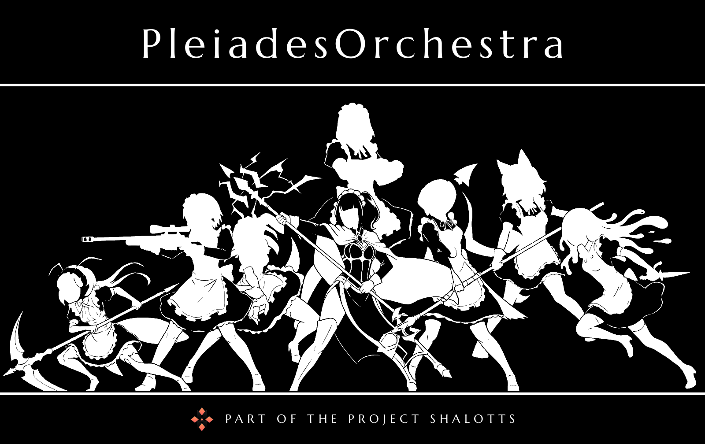

<div align="center">



**Open-source orchestrator with GOAP for tiny models. Provides website chatbot widget with 
custom providers. Main target its working with website or service mcp/webmcp for automatization 
from client side**

[](https://bun.com)
[](https://www.typescriptlang.org)
[](https://turborepo.com)
[](https://elysiajs.com)
[](https://svelte.dev)
[](https://www.sqlite.org)
[](https://docs.docker.com/compose/)
[](https://modelcontextprotocol.io)
[](https://biomejs.dev)

[](https://github.com/francyfox/PleiadesOrchestra/pkgs/container/pleiades)
[](https://www.npmjs.com/package/@shalotts/pleiades-widget)
[](#quick-start)
[](docs/)

</div>

## What it is

- **MCP and web-MCP for websites** — simple sites and online shops now, CRM and BI later.
- **A chatbot for customers** that uses our own and third-party MCP/web-MCP to perform simple operations on a site: find a product, add it to the cart, remove it, compare.
- **GOAP planning**: the orchestrator builds a chain of actions towards a goal instead of running one big prompt.
- Agents work with facts and prepared answers; they don't promise professional consultation or the accuracy of large models.

## Quick start

One command on Linux or macOS (installs Docker if missing, generates keys, runs the stack and the admin panel as one container `ghcr.io/francyfox/pleiades`):

```bash
curl -fsSL https://raw.githubusercontent.com/francyfox/PleiadesOrchestra/master/scripts/install.sh | bash
```

From a checkout, for development:

```bash
bun install
cp .env.example .env            # and apps/*/.env.example → apps/*/.env
docker compose up --build       # the whole stack; one service: docker compose up -d --build <service>
```

```bash
bun run test                    # tests of every package via turbo
bun run lint                    # Biome
bun run check-types
```

The Telegram bot runs on a webhook — it needs a public URL forwarded to `localhost:3001` (`TELEGRAM_WEBHOOK_URL`).

### `albedo` CLI

A single binary for working with a running stack. Install it once (Linux, macOS or Windows Git Bash; needs Bun to build):

```bash
scripts/install-albedo.sh       # builds ./albedo for this OS/CPU and links it into ~/.local/bin (or pass a dir)
```

Then, from any directory:

```bash
albedo admin:create --email you@example.com   # first admin = super admin; prints the sign-in token once
```

`admin:create` runs inside the `admin-api` container (`docker compose up -d admin-api` first). For an existing admin it issues a new token, and the old one stops working.

## Components

### The Pleiades

The agent services, each named after one of the Pleiades Six Stars

| Service                                                     | Role                                                                     |
| ----------------------------------------------------------- | ------------------------------------------------------------------------ |
| [`alpha-orchestrator`](apps/alpha-orchestrator/README.md)   | Orchestrator: GOAP planner, users, access, history, token usage (SQLite) |
| [`beta-text`](apps/beta-text/README.md)                     | Text model                                                               |
| [`gamma-decision`](apps/gamma-decision/README.md)           | Fast typed decisions                                                     |
| [`delta-function-call`](apps/delta-function-call/README.md) | Function-call model: fills in tool-call arguments for the planner        |

### Everything else

| Path                                   | Role                                                    |
| -------------------------------------- | ------------------------------------------------------- |
| `apps/telegram-bot`, `apps/cli`        | Transports — thin clients of the orchestrator           |
| `apps/admin-api`, `apps/admin`         | Admin panel: API with accounts, and a static Svelte SPA |
| `packages/core`, `packages/elysia-kit` | GOAP core and shared Elysia setup                       |

## Documentation

All the main documentation lives in [`docs/`](docs/). Repository rules and lessons learned are in [`CLAUDE.md`](CLAUDE.md).

## References

- [goap-js](https://github.com/wmdmark/goap-js/tree/master) — a reference GOAP implementation
- [embabel](https://github.com/embabel/embabel-agent) - goap framework

## License

Copyright (C) 2026 Danil Golota

Licensed under the [GNU Affero General Public License v3.0](LICENSE) (`AGPL-3.0-only`), except [`packages/pleiades-widget`](packages/pleiades-widget), the chat widget that sites embed, which is under the [BSD 3-Clause License](packages/pleiades-widget/LICENSE).

A commercial license is available if you can't use the AGPL: see [COMMERCIAL.md](COMMERCIAL.md). Third-party notices: [NOTICE](NOTICE).
